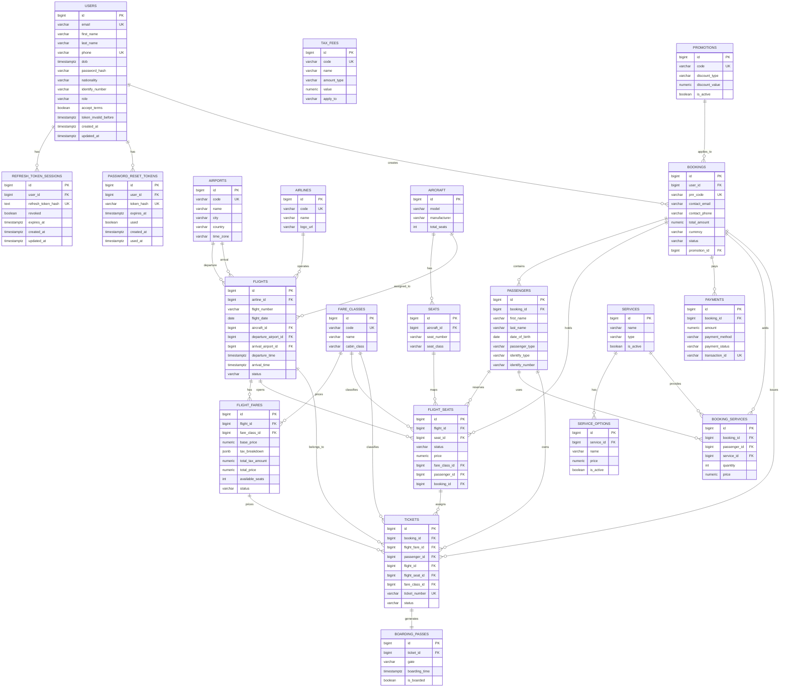

<div align="center">

# Airline Booking Backend System

[](https://openjdk.org/)
[](https://spring.io/projects/spring-boot)
[](https://gradle.org/)
[](https://www.postgresql.org/)
[](https://flywaydb.org/)
[](https://redis.io/)

**Modular monolith backend cho hệ thống đặt vé máy bay, mô phỏng luồng tìm chuyến bay -> đặt vé -> thanh toán -> check-in -> boarding**

[Features](#-features) •
[Tech Stack](#-tech-stack) •
[Quick Start](#-quick-start) •
[API Docs](#-api-endpoints) •
[Documentation](#-documentation)

</div>

---

## 📋 Table of Contents

- [About the Project](#-about-the-project)
- [Features](#-features)
- [Tech Stack](#-tech-stack)
- [Architecture Overview](#-architecture-overview)
- [Quick Start](#-quick-start)
- [Environment Variables](#-environment-variables)
- [API Endpoints](#-api-endpoints)
- [Project Structure](#-project-structure)
- [Database Schema](#-database-schema)
- [Business Rules](#-business-rules)
- [Development](#-development)
- [Testing](#-testing)
- [Security Overview](#-security-overview)
- [Documentation](#-documentation)

---

## ✈️ About the Project

**Airline Booking Backend System** là backend cho bài toán đặt vé máy bay, tập trung vào các luồng nghiệp vụ chính:

- Tìm kiếm chuyến bay theo chặng, ngày bay, hạng vé
- Tạo booking và sinh mã `PNR`
- Giữ chỗ ghế trong thời gian thanh toán
- Thanh toán và phát hành vé điện tử
- Quản lý booking sau thanh toán
- Check-in online và tạo boarding pass
- Notification và các xử lý nền theo lịch

### Core User Roles

| Role | Description |
|------|-------------|
| **Passenger** | Tìm chuyến bay, đặt vé, thanh toán, check-in, quản lý booking |
| **Admin / Manager** | Quản lý chuyến bay, ghế, dữ liệu vận hành và báo cáo |

### Booking Flow

```text
Search Flight
  -> Select Flight + Fare
  -> Enter Passenger Info
  -> Create Booking (PNR)
  -> Select Seat + Add-ons
  -> Payment
  -> Ticket Issued
  -> Check-in Online
  -> Boarding Pass
  -> Boarding
```

---

## ✨ Features

### 🔐 Authentication & User Profile
- Đăng ký tài khoản
- Xác thực email bằng OTP
- Đăng nhập, refresh token, đăng xuất
- Quên mật khẩu và đặt lại mật khẩu bằng OTP
- Cập nhật hồ sơ người dùng

### 🔎 Flight Search
- Tìm kiếm chuyến bay theo điểm đi, điểm đến, ngày bay
- Hỗ trợ one-way, round-trip, multi-city trong tài liệu thiết kế
- Lọc theo hãng bay, khung giờ, giá tối đa, hạng ghế, chuyến bay thẳng
- Xem sơ đồ ghế và ancillary services theo chuyến bay

### 🎫 Booking & Ticketing
- Tạo booking từ kết quả `revalidate-fare`
- Sinh mã `PNR` và trạng thái `PENDING_PAYMENT`
- Chọn ghế cho từng hành khách
- Chọn dịch vụ bổ sung như hành lý, suất ăn
- Áp dụng mã khuyến mãi
- Phát hành e-ticket sau thanh toán thành công

### 💳 Payment
- Khởi tạo thanh toán
- Polling trạng thái thanh toán
- Xử lý webhook từ cổng thanh toán
- Đồng bộ trạng thái `booking`, `payment`, `seat`, `ticket`

### 🛫 Check-in & Boarding
- Check-in online trong khung thời gian cho phép
- Xác nhận ghế khi check-in
- Tạo boarding pass với QR data
- Khóa chỉnh sửa booking sau khi check-in

### ⏰ Background Jobs & Notifications
- Tự động hết hạn booking chưa thanh toán
- Tự động trả ghế về trạng thái khả dụng
- Gửi email xác nhận booking, hủy vé, hoàn tiền
- Nhắc check-in trước giờ bay
- Theo dõi và thông báo thay đổi trạng thái chuyến bay

### 🛡️ Platform Concerns
- JWT access token + refresh token rotation
- Redis rate limiting cho login, reset password, refresh token
- Global exception handling
- Request ID propagation cho observability
- Swagger/OpenAPI cho môi trường phù hợp

---

## 🛠 Tech Stack

<table>
<tr>
<td>

### Core

| Component | Technology |
|-----------|------------|
| **Language** | [Java](https://openjdk.org/) 21 |
| **Framework** | [Spring Boot](https://spring.io/projects/spring-boot) 4.0.5 |
| **Build Tool** | [Gradle](https://gradle.org/) 9.x Wrapper |
| **Architecture** | Modular Monolith |
| **Database** | [PostgreSQL](https://www.postgresql.org/) 16 |
| **Migrations** | [Flyway](https://flywaydb.org/) |

</td>
<td>

### Integrations

| Component | Technology |
|-----------|------------|
| **Auth** | Spring Security + JWT |
| **Persistence** | Spring Data JPA |
| **Rate Limiting** | Redis |
| **API Docs** | Springdoc OpenAPI |
| **Logging** | Logback + Logstash encoder |
| **Testing** | JUnit 5 + Spring Boot Test + JaCoCo |

</td>
</tr>
</table>

---

## 🏗 Architecture Overview

### Module Layout

| Module | Responsibility |
|--------|----------------|
| `app-bootstrap` | Spring Boot entry point, web layer, security, OpenAPI, runtime wiring |
| `common` | Shared exceptions, common contracts, reusable utilities |
| `database` | Database-related shared layer và Flyway migrations |
| `module-identity` | Authentication, profile, password reset, refresh session |
| `module-flight` | Flight, airport, airline, fare, aircraft, seat inventory |
| `module-booking` | Booking, passenger, seat hold, ancillaries, tickets |
| `module-payment` | Payment domain và transaction status |
| `module-checkin` | Check-in và boarding-pass flow |
| `module-notification` | Notification use cases |
| `module-scheduler` | Scheduled jobs như expire booking |

### Application Layers

```text
Clients
  -> REST API (Spring Boot)
  -> Security / Validation / Error Handling / Rate Limiting
  -> Business Modules
  -> PostgreSQL / Redis / Mail / Payment Provider
```

### Current Implementation Note

Repository hiện đã có web layer cho nhóm nghiệp vụ `identity` và đã chuẩn bị cấu trúc module cho các nhóm nghiệp vụ còn lại. Phần scope nghiệp vụ của booking, payment, check-in, ticketing trong README này được tổng hợp từ tài liệu đặc tả trong `docs/`.

---

## 🚀 Quick Start

### Prerequisites

- JDK 21
- PostgreSQL 16+
- Redis
- PowerShell hoặc terminal tương thích để chạy Gradle Wrapper

### Installation

```bash
# Clone repository
git clone <your-repository-url>
cd airline-booking

# Copy env template
cp .env.example .env

# Update values for local environment
```

### Run Locally

```powershell
# Format and verify code style
.\gradlew formatCode

# Run application
.\gradlew :app-bootstrap:bootRun
```

Hoặc dùng script local:

```powershell
.\scripts\run-local.ps1
```

### Verify Installation

```bash
# Health endpoint
curl http://localhost:8080/actuator/health

# Swagger UI
http://localhost:8080/swagger-ui.html

# OpenAPI
http://localhost:8080/v3/api-docs
```

---

## 📜 Available Commands

| Command | Description |
|--------|-------------|
| `.\gradlew tasks --all` | Liệt kê toàn bộ Gradle tasks |
| `.\gradlew :app-bootstrap:bootRun` | Chạy ứng dụng chính |
| `.\scripts\run-local.ps1` | Nạp `.env` rồi chạy local |
| `.\gradlew formatCode` | Format toàn bộ project bằng Spotless |
| `.\gradlew qualityGate` | Chạy format check, test, jacoco, checkstyle |
| `.\gradlew installGitHooks` | Cài pre-push hook dùng chung |
| `.\gradlew test` | Chạy test cho các module |

---

## 🔧 Environment Variables

Các biến môi trường mẫu đã được khai báo trong `.env.example`.

### Required Variables

```bash
# PROFILE / SERVER
SPRING_PROFILES_ACTIVE=local
SERVER_PORT=8080

# DATABASE
SPRING_DATASOURCE_URL=jdbc:postgresql://localhost:5432/airline_booking
SPRING_DATASOURCE_USERNAME=postgres
SPRING_DATASOURCE_PASSWORD=postgres

# JWT
APP_JWT_SECRET=change-me-super-secret-key
APP_JWT_ACCESS_TOKEN_EXPIRATION_MINUTES=15
APP_JWT_REFRESH_TOKEN_EXPIRATION_DAYS=7

# REDIS
SPRING_DATA_REDIS_HOST=localhost
SPRING_DATA_REDIS_PORT=6379

# MAIL
SPRING_MAIL_HOST=smtp.gmail.com
SPRING_MAIL_PORT=587
SPRING_MAIL_USERNAME=your-email@gmail.com
SPRING_MAIL_PASSWORD=your-app-password
APP_MAIL_FROM=noreply@airline-booking.com
```

### Important Optional Variables

```bash
# COOKIE / CORS
APP_AUTH_REFRESH_COOKIE_NAME=refresh_token
APP_AUTH_REFRESH_COOKIE_PATH=/api/auth
APP_CORS_ALLOWED_ORIGIN_PATTERNS=http://localhost:3000,http://localhost:5173

# RATE LIMIT
APP_RATE_LIMIT_ENABLED=true
# Keep false in production so a Redis outage cannot bypass authentication throttling.
APP_RATE_LIMIT_FAIL_OPEN=false
APP_RATE_LIMIT_LOGIN_WINDOW=10m
APP_RATE_LIMIT_LOGIN_EMAIL_LIMIT=5
APP_RATE_LIMIT_LOGIN_CLIENT_LIMIT=20
APP_RATE_LIMIT_LOGIN_PAIR_LIMIT=5
APP_RATE_LIMIT_PASSWORD_RESET_WINDOW=15m
APP_RATE_LIMIT_PASSWORD_RESET_EMAIL_LIMIT=3
APP_RATE_LIMIT_PASSWORD_RESET_CLIENT_LIMIT=10
APP_RATE_LIMIT_PASSWORD_RESET_PAIR_LIMIT=3
APP_RATE_LIMIT_REFRESH_WINDOW=5m
APP_RATE_LIMIT_REFRESH_USER_LIMIT=20
APP_RATE_LIMIT_REFRESH_CLIENT_LIMIT=60

# BOOKING RULES
APP_BOOKING_PNR_EXPIRATION_MINUTES=15
APP_BOOKING_CHECKIN_OPEN_HOURS=24
APP_BOOKING_DOMESTIC_CHECKIN_CLOSE_MINUTES=40
APP_BOOKING_INTERNATIONAL_CHECKIN_CLOSE_MINUTES=60

# PAYMENT
APP_PAYMENT_PROVIDER=payos
APP_PAYMENT_WEBHOOK_SECRET=change-me
APP_PAYMENT_RETURN_URL=http://localhost:3000/payment/success
APP_PAYMENT_CANCEL_URL=http://localhost:3000/payment/cancel

# SWAGGER / LOGGING
APP_SWAGGER_ENABLED=true
APP_REQUEST_ID_HEADER=X-Request-Id
APP_LOG_JSON_ENABLED=false
```

### Profiles

| Profile | Usage |
|---------|-------|
| `local` | Local development |
| `staging` | Staging / preview deployment |
| `prod` | Production deployment |

---

## 📡 API Endpoints

### Response Convention

**Success**

```json
{
  "success": true,
  "data": {},
  "message": "Operation successful"
}
```

**Error**

```json
{
  "success": false,
  "error": {
    "code": "ERROR_CODE",
    "message": "Validation failed",
    "details": {}
  },
  "statusCode": 400,
  "timestamp": "2026-04-08T00:00:00Z",
  "path": "/api/example",
  "requestId": "..."
}
```

### Authentication

| Method | Endpoint | Description | Auth |
|--------|----------|-------------|------|
| `POST` | `/api/auth/register` | Đăng ký tài khoản | Public |
| `POST` | `/api/auth/send-verify-otp` | Gửi OTP xác thực email | Public |
| `POST` | `/api/auth/verify-email` | Xác thực OTP email | Public |
| `POST` | `/api/auth/login` | Đăng nhập | Public |
| `POST` | `/api/auth/refresh` | Làm mới access token | Public |
| `POST` | `/api/auth/logout` | Đăng xuất | Authenticated |
| `POST` | `/api/auth/forgot-password` | Gửi OTP reset password | Public |
| `POST` | `/api/auth/reset-password` | Đặt lại mật khẩu | Public |
| `POST` | `/api/auth/change-password` | Đổi mật khẩu | Authenticated |

### Users

| Method | Endpoint | Description | Auth |
|--------|----------|-------------|------|
| `GET` | `/api/users/me` | Lấy thông tin user hiện tại | Authenticated |
| `PATCH` | `/api/users/me` | Cập nhật hồ sơ | Authenticated |

### Planned Business Endpoints

Theo tài liệu API trong `docs/api/endpoints.md`, hệ thống còn bao phủ các nhóm endpoint sau:

- `GET /api/flights/search`, `POST /api/flights/revalidate-fare`
- `POST /api/bookings`, `POST /api/bookings/:id/seats`, `POST /api/bookings/:id/services`
- `POST /api/payments`, `GET /api/payments/{paymentId}`, `POST /api/payments/webhooks/payos`
- `POST /api/checkin`, `GET /api/checkin/boarding-pass/:booking_id`
- `GET /api/tickets`, `GET /api/tickets/:ticket_number`, `GET /api/tickets/lookup`

### Swagger

| Endpoint | Purpose |
|----------|---------|
| `/swagger-ui.html` | Swagger UI |
| `/v3/api-docs` | OpenAPI JSON |
| `/actuator/health` | Health check |

---

## 📁 Project Structure

```text
airline-booking/
├── app-bootstrap/          # Spring Boot application entry point
├── common/                 # Shared classes and exceptions
├── database/               # Flyway migrations and shared database layer
├── module-identity/        # Auth, user profile, password reset, refresh token
├── module-flight/          # Flight, airport, airline, fare, seat inventory
├── module-booking/         # Booking, passenger, services, ticketing
├── module-payment/         # Payment domain
├── module-checkin/         # Check-in and boarding pass
├── module-notification/    # Notification logic
├── module-scheduler/       # Scheduled/background jobs
├── docs/
│   ├── api/
│   └── specs/
├── scripts/
├── config/checkstyle/
├── build.gradle
├── settings.gradle
├── Dockerfile
└── .env.example
```

---

## 🗄 Database Schema

Database được quản lý bằng **Flyway SQL migrations** và chia theo các nhóm nghiệp vụ chính:

- Identity và user profile
- Flights, airlines, airports, aircraft, seats
- Bookings, passengers, services, promotions
- Payments
- Tickets và boarding passes

### Main Entities

| Group | Entities |
|------|----------|
| **Identity** | `users`, `refresh_token_sessions`, `password_reset_tokens` |
| **Flight** | `airports`, `airlines`, `aircraft`, `seats`, `flights`, `flight_fares`, `tax_fees` |
| **Booking** | `bookings`, `passengers`, `flight_seats`, `booking_services`, `promotions` |
| **Payment** | `payments` |
| **Ticketing** | `tickets`, `boarding_passes` |

### Entity Relationship Diagram



### Source of Truth

- Flyway là nguồn chính để tạo và cập nhật schema
- JPA entities map theo schema migration
- Môi trường staging/production nên dùng:
  - `SPRING_JPA_HIBERNATE_DDL_AUTO=validate`
  - `SPRING_FLYWAY_ENABLED=true`

Migration files hiện đặt tại:

- `database/src/main/resources/db/migration`
- `app-bootstrap/src/main/resources/db/migration`

---

## 📐 Business Rules

### Booking & PNR
- Booking được tạo với trạng thái `PENDING_PAYMENT`
- Hệ thống sinh `pnr_expires_at = current_time + 15 phút`
- `POST /api/flights/revalidate-fare` chỉ tính lại giá, kiểm tra còn đủ ghế cho `adult + child`, và trả `revalidateId`; bước này chưa reserve ghế
- `POST /api/bookings` dùng `revalidateId`, validate tuổi hành khách theo `flightDate`, rồi reserve ghế cho `adult + child`
- Khi thanh toán thành công, booking chuyển sang `CONFIRMED`

### Payment Expiry & Frontend UX
- `POST /api/payments` trả về `payment.expireAt` là **`pnr_expires_at`** (deadline thanh toán/giữ chỗ), frontend nên dùng field này để **đếm ngược**.
- `qrData` có thể dùng để render QR (tuỳ UX), nhưng nguồn điều hướng chính vẫn là `action.paymentUrl` (PayOS checkout URL).
- Backend có thể **gia hạn cửa sổ thanh toán/giữ chỗ thêm 5 phút** (tối đa 1 lần/booking) khi người dùng bắt đầu thanh toán sát giờ, để tránh hết hạn giữa chừng.
- Khuyến nghị UI:
  - Remaining còn nhiều: hiển thị QR/nút thanh toán bình thường
  - Remaining sắp hết hạn: vẫn cho thanh toán nhưng cảnh báo “Sắp hết hạn”
  - Remaining `<= 15–30s`: (tuỳ chọn) disable thanh toán để tránh rủi ro hết hạn giữa chừng

### Seat Locking

| Action | Condition | Result |
|--------|-----------|--------|
| Chọn ghế | `seat.status = AVAILABLE` | `RESERVED` |
| Thanh toán thành công | `booking.status = CONFIRMED` | `BOOKED` |
| Hết hạn PNR | Cron job | `AVAILABLE` |
| Hủy booking | Booking cancelled | `AVAILABLE` |

### Passenger Pricing & Seat Rules
- `ADULT`: từ 12 tuổi trở lên, tính 100% giá người lớn và có ghế.
- `CHILD`: từ 2 đến dưới 12 tuổi, tính 75% giá người lớn và có ghế.
- `INFANT`: dưới 2 tuổi, tính 10% giá người lớn và không có ghế.
- `INFANT` không được nhiều hơn `ADULT`.
- Validate tuổi thật của từng passenger được thực hiện ở bước tạo booking dựa trên `dateOfBirth` và `flightDate`.

### Check-in Window
- Check-in online mở trước `24 giờ`
- Đóng trước `40 phút` với chuyến nội địa
- Đóng trước `60 phút` với chuyến quốc tế
- Booking phải ở trạng thái `CONFIRMED`

### Auto Expire
- Cron job quét các booking quá hạn thanh toán
- Booking `PENDING_PAYMENT` quá TTL sẽ chuyển sang `EXPIRED`
- Toàn bộ ghế giữ chỗ được trả về `AVAILABLE`

### Cancellation & Refund
- Chỉ cho hủy booking đã `CONFIRMED`
- Không cho hủy nếu vé đã `CHECKED_IN`, `NO_SHOW`, hoặc booking đã hoàn tất
- Sau refund thành công:
  - `booking -> CANCELLED`
  - `payment -> REFUNDED`
  - `ticket -> CANCELLED`
  - `seat -> AVAILABLE`

---

## 💻 Development

### Suggested Workflow

```bash
# Format code
.\gradlew formatCode

# Run checks and tests
.\gradlew qualityGate

# Start application
.\gradlew :app-bootstrap:bootRun
```

### Quality Tooling

- Spotless for formatting
- Checkstyle for static code style checks
- JaCoCo for coverage report
- Shared pre-push hook via `installGitHooks`

### Local Notes

- `app-bootstrap` là Spring Boot app duy nhất để chạy toàn hệ thống
- Các `module-*` là library/business modules, không chạy độc lập như service riêng
- `scripts/run-local.ps1` là cách nhanh nhất để chạy local với `.env`

---

## 🧪 Testing

### Test Stack

- JUnit 5
- Spring Boot Test
- Spring Security Test
- JaCoCo
- H2 in-memory cho test bootstrap

### Useful Commands

```bash
.\gradlew test
.\gradlew :app-bootstrap:test
.\gradlew qualityGate
```

### Current Test Focus

- Authentication service
- Password reset service
- Refresh token session flow
- JWT authentication filter
- Auth controller integration
- Rate limiting integration

---

## 🔒 Security Overview

### Authentication & Authorization
- JWT access token + refresh token
- Refresh token rotation và revoke session cũ
- Spring Security bảo vệ route
- Refresh token cookie có cấu hình `httpOnly`, `sameSite`, `secure`

### API Protection
- Redis-backed rate limiting cho login, reset password, refresh token
- Global validation và standardized error response
- CORS cấu hình theo allowed origin patterns
- Request ID gắn vào response và log

### Data & Infrastructure
- Password hashing ở identity module
- PostgreSQL cho dữ liệu chính
- Redis cho throttle/rate limit state
- Flyway để kiểm soát schema thay đổi

---

## 📚 Documentation

| Document | Description |
|----------|-------------|
| `docs/specs/index.md` | Tổng quan đặc tả dự án |
| `docs/specs/overview.md` | Bối cảnh và core flow nghiệp vụ |
| `docs/specs/use_case.md` | Danh sách use case |
| `docs/specs/business_rule.md` | Business rules chi tiết |
| `docs/specs/state_machine_design.md` | Thiết kế state machine |
| `docs/specs/user_story.md` | User stories |
| `docs/api/endpoints.md` | API contract dự kiến |
| `README.md` | Tổng quan kỹ thuật và cách chạy dự án |

---

## 📄 License

This project is currently used for academic / internal development purposes. Update the license section when the repository licensing policy is finalized.
