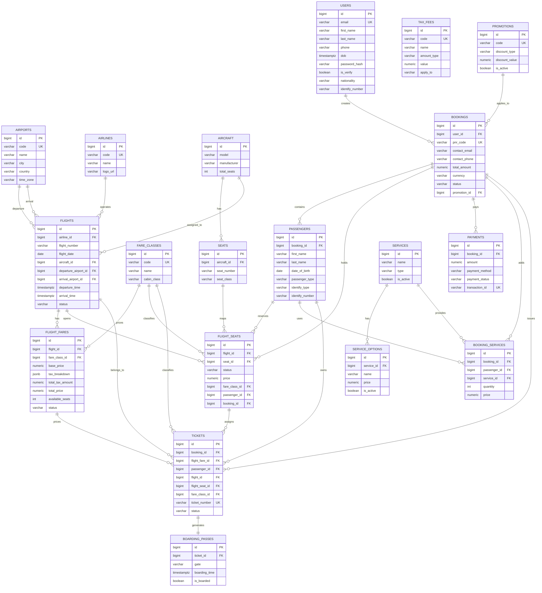

<div align="center">

# Airline Booking Backend

[](https://openjdk.org/)
[](https://spring.io/projects/spring-boot)
[](https://gradle.org/)
[](https://www.postgresql.org/)
[](https://flywaydb.org/)

Multi-module backend system for airline booking workflows built with Java, Spring Boot, and Gradle.

[Architecture](#architecture) •
[Configuration](#configuration) •
[Quick Start](#quick-start) •
[VS Code Workflow](#vs-code-workflow) •
[IntelliJ Run Configuration](#intellij-run-configuration) •
[Railway Production Config](#railway-production-config)

</div>

---

## Overview

`airline-booking` la backend dang `modular monolith` voi `Gradle multi-module`.

Hien tai:

- `app-bootstrap` la Spring Boot application duy nhat de chay he thong
- `common`, `database`, va cac `module-*` la library/business modules
- root project dong vai tro aggregator cho toan bo build

Muc tieu cua repo nay la phat trien backend cho bai toan:

- search flight
- booking + PNR
- payment
- ticket
- check-in
- notification

---

## Architecture

### Modules

| Module | Role |
| --- | --- |
| `app-bootstrap` | Entry point chinh, tap hop toan bo modules va khoi dong Spring Boot |
| `common` | Shared code dung chung |
| `database` | Database-related shared layer |
| `module-identity` | Identity/authentication |
| `module-flight` | Flight business logic |
| `module-booking` | Booking business logic |
| `module-payment` | Payment business logic |
| `module-checkin` | Check-in business logic |
| `module-notification` | Notification business logic |
| `module-scheduler` | Background jobs / scheduled tasks |

### Project Structure

```text
airline-booking/
├── app-bootstrap/
├── common/
├── database/
├── module-identity/
├── module-flight/
├── module-booking/
├── module-payment/
├── module-checkin/
├── module-notification/
├── module-scheduler/
├── build.gradle
├── settings.gradle
└── .env.example
```

### Runtime Entry Point

Ung dung chay chinh nam tai:

- [AppBootstrapApplication.java](/d:/Workspace/CNPM/AirlineBooking/airline-booking/app-bootstrap/src/main/java/com/example/appbootstrap/AppBootstrapApplication.java)

---

## Configuration

### Main Config Files

Config runtime chinh duoc dat tai `app-bootstrap/src/main/resources`:

- [application.yml](/d:/Workspace/CNPM/AirlineBooking/airline-booking/app-bootstrap/src/main/resources/application.yml)
- [application-local.yml](/d:/Workspace/CNPM/AirlineBooking/airline-booking/app-bootstrap/src/main/resources/application-local.yml)
- [application-staging.yml](/d:/Workspace/CNPM/AirlineBooking/airline-booking/app-bootstrap/src/main/resources/application-staging.yml)
- [application-prod.yml](/d:/Workspace/CNPM/AirlineBooking/airline-booking/app-bootstrap/src/main/resources/application-prod.yml)

Template env dat tai:

- [.env.example](/d:/Workspace/CNPM/AirlineBooking/airline-booking/.env.example)

Test config rieng van giu o:

- [app-bootstrap/src/test/resources/application.properties](/d:/Workspace/CNPM/AirlineBooking/airline-booking/app-bootstrap/src/test/resources/application.properties)

### Config Responsibility

#### `application.yml`

Chua config chung:

- app name
- active profile
- server port
- Swagger enable/path
- actuator endpoints
- custom `app.*` config:
  - `app.jwt.*`
  - `app.booking.*`
  - `app.payment.*`
  - `app.mail.from`

#### `application-local.yml`

Chua config local:

- PostgreSQL datasource local
- JPA local settings
- Flyway local settings
- mail local settings

#### `application-prod.yml`

Chua config production:

- PostgreSQL / Supabase datasource
- JPA production settings
- Flyway production settings
- mail production settings
- logging level production
- Swagger tat o production

#### `application-staging.yml`

Chua config staging:

- PostgreSQL / Supabase datasource
- JPA staging settings
- Flyway staging settings
- mail staging settings
- logging level staging
- Swagger bat o staging

### Environment Variables

Bien moi truong mau da duoc khai bao trong `.env.example`.

Nhom bien quan trong:

- profile
  - `SPRING_PROFILES_ACTIVE`
  - `SERVER_PORT`
- datasource
  - `SPRING_DATASOURCE_URL`
  - `SPRING_DATASOURCE_USERNAME`
  - `SPRING_DATASOURCE_PASSWORD`
- JPA / Flyway
  - `SPRING_JPA_HIBERNATE_DDL_AUTO`
  - `SPRING_JPA_SHOW_SQL`
  - `SPRING_FLYWAY_ENABLED`
- JWT
  - `APP_JWT_SECRET`
  - `APP_JWT_ACCESS_TOKEN_EXPIRATION_MINUTES`
  - `APP_JWT_REFRESH_TOKEN_EXPIRATION_DAYS`
- booking rules
  - `APP_BOOKING_PNR_EXPIRATION_MINUTES`
  - `APP_BOOKING_CHECKIN_OPEN_HOURS`
  - `APP_BOOKING_DOMESTIC_CHECKIN_CLOSE_MINUTES`
  - `APP_BOOKING_INTERNATIONAL_CHECKIN_CLOSE_MINUTES`
- payment
  - `APP_PAYMENT_PROVIDER`
  - `APP_PAYMENT_WEBHOOK_SECRET`
  - `APP_PAYMENT_RETURN_URL`
  - `APP_PAYMENT_CANCEL_URL`
- mail
  - `SPRING_MAIL_HOST`
  - `SPRING_MAIL_PORT`
  - `SPRING_MAIL_USERNAME`
  - `SPRING_MAIL_PASSWORD`
  - `SPRING_MAIL_SMTP_AUTH`
  - `SPRING_MAIL_SMTP_STARTTLS_ENABLE`
  - `APP_MAIL_FROM`
- Swagger
  - `APP_SWAGGER_ENABLED`

### Supabase Notes

Staging va production deu co the dung Supabase PostgreSQL.

JDBC URL mau:

```text
jdbc:postgresql://aws-1-<region>.pooler.supabase.com:6543/postgres?sslmode=require
```

Username mau:

```text
postgres.<project-ref>
```

---

## Quick Start

## API Response Convention

Toan bo web layer dang dung response format thong nhat tai `app-bootstrap`.

### Success Response

Controller tra object binh thuong se duoc auto-wrap thanh:

```json
{
  "success": true,
  "data": {},
  "message": "Operation successful"
}
```

Neu muon custom message thanh cong, dung annotation:

- `@ApiSuccessMessage("Booking created successfully")`

Files lien quan:

- [ApiSuccessMessage.java](/d:/Workspace/CNPM/AirlineBooking/airline-booking/app-bootstrap/src/main/java/com/example/appbootstrap/api/ApiSuccessMessage.java)
- [ApiSuccessResponse.java](/d:/Workspace/CNPM/AirlineBooking/airline-booking/app-bootstrap/src/main/java/com/example/appbootstrap/api/ApiSuccessResponse.java)
- [ApiSuccessResponseBodyAdvice.java](/d:/Workspace/CNPM/AirlineBooking/airline-booking/app-bootstrap/src/main/java/com/example/appbootstrap/api/ApiSuccessResponseBodyAdvice.java)

### Error Response

Loi duoc tra ve theo format:

```json
{
  "success": false,
  "error": {
    "code": "VALIDATION_ERROR",
    "message": "Validation failed",
    "details": {
      "field": "message"
    }
  },
  "statusCode": 400,
  "timestamp": "2026-03-30T12:00:00Z",
  "path": "/api/bookings",
  "requestId": "..."
}
```

### Global Exception Handling

`GlobalExceptionHandler` nam trong `app-bootstrap` va ap dung chung cho toan bo application web.

No dang xu ly 3 nhom loi chinh:

- business exception
  - `AppException`
- request / validation / HTTP exception
  - `MethodArgumentNotValidException`
  - `ConstraintViolationException`
  - `HttpMessageNotReadableException`
  - `MissingServletRequestParameterException`
  - `HttpRequestMethodNotSupportedException`
  - `NoResourceFoundException`
  - `AccessDeniedException`
- system exception
  - `Exception`

Files lien quan:

- [AppException.java](/d:/Workspace/CNPM/AirlineBooking/airline-booking/app-bootstrap/src/main/java/com/example/appbootstrap/exception/AppException.java)
- [ApiError.java](/d:/Workspace/CNPM/AirlineBooking/airline-booking/app-bootstrap/src/main/java/com/example/appbootstrap/exception/ApiError.java)
- [ApiErrorResponse.java](/d:/Workspace/CNPM/AirlineBooking/airline-booking/app-bootstrap/src/main/java/com/example/appbootstrap/exception/ApiErrorResponse.java)
- [GlobalExceptionHandler.java](/d:/Workspace/CNPM/AirlineBooking/airline-booking/app-bootstrap/src/main/java/com/example/appbootstrap/exception/GlobalExceptionHandler.java)

### Request ID

Moi HTTP request deu duoc `RequestIdFilter` gan `requestId` vao MDC.

Dieu nay co nghia la:

- log se tu dong co `requestId`
- error response se tra ve `requestId`
- response header se co `X-Request-Id` mac dinh

File lien quan:

- [RequestIdFilter.java](/d:/Workspace/CNPM/AirlineBooking/airline-booking/app-bootstrap/src/main/java/com/example/appbootstrap/config/RequestIdFilter.java)

---

## Database Schema

### Entity Relationship Diagram

Database schema cua du an duoc quan ly bang Flyway va duoc chia theo cac nhom nghiep vu:

- identity
- flights and inventory
- bookings and passengers
- payments
- services and promotions
- tickets and boarding passes

Migration SQL hien tai duoc dat tai:

- [app-bootstrap/src/main/resources/db/migration](/d:/Workspace/CNPM/AirlineBooking/airline-booking/app-bootstrap/src/main/resources/db/migration)



### Source Of Truth

Quy uoc hien tai:

- Flyway la nguon chinh de tao va thay doi schema
- JPA entity map theo schema migration
- production / integration mode nen uu tien:
  - `SPRING_JPA_HIBERNATE_DDL_AUTO=validate`
  - `SPRING_FLYWAY_ENABLED=true`

---

### Prerequisites

- JDK 21
- Gradle wrapper
- PostgreSQL local hoac Supabase database

### Useful Commands

```powershell
.\gradlew tasks --all
.\gradlew formatCode
.\gradlew qualityGate
.\gradlew :app-bootstrap:bootRun
.\scripts\run-local.ps1
```

### Swagger URL

Sau khi app chay:

- `http://localhost:8080/swagger-ui.html`
- `http://localhost:8080/swagger-ui/index.html`
- `http://localhost:8080/v3/api-docs`

### Flyway

`app-bootstrap` da co dependency Flyway, nhung migration chi co y nghia khi module `database` co script migration thuc te.

---

## VS Code Workflow

### Files Added for VS Code

- [.vscode/launch.json](/d:/Workspace/CNPM/AirlineBooking/airline-booking/.vscode/launch.json)
- [scripts/run-local.ps1](/d:/Workspace/CNPM/AirlineBooking/airline-booking/scripts/run-local.ps1)

### Recommended Way

Cach thuc te va on nhat cho VS Code:

1. chinh gia tri local trong `.env`
2. mo terminal PowerShell trong VS Code
3. chay:

```powershell
.\scripts\run-local.ps1
```

Script se:

- doc `.env`
- nap cac bien vao process hien tai
- chay `:app-bootstrap:bootRun`

### Debug in VS Code

Neu muon debug:

1. mo tab `Run and Debug`
2. chon:
   - `Debug AppBootstrapApplication`
3. bam `Start Debugging`

Luu y:

- `launch.json` dang chua mot bo `env` local co san
- neu ban doi gia tri local trong `.env`, can cap nhat lai `launch.json` neu muon debug dung cung gia tri do

### When to Use Which

- run app nhanh: dung `.\scripts\run-local.ps1`
- debug breakpoints: dung `.vscode/launch.json`

---

## IntelliJ Run Configuration

### Local Run

1. Mo dung root project:
   - `d:\Workspace\CNPM\AirlineBooking\airline-booking`
2. Vao `Run -> Edit Configurations`
3. Tao hoac chon Spring Boot configuration cho:
   - `AppBootstrapApplication`
4. Chon module classpath:
   - `app-bootstrap`
5. O muc `Environment variables`, set toi thieu:

```text
SPRING_PROFILES_ACTIVE=local;
SERVER_PORT=8080;
SPRING_DATASOURCE_URL=jdbc:postgresql://localhost:5432/airline_booking;
SPRING_DATASOURCE_USERNAME=postgres;
SPRING_DATASOURCE_PASSWORD=postgres;
SPRING_JPA_HIBERNATE_DDL_AUTO=validate;
SPRING_JPA_SHOW_SQL=true;
SPRING_FLYWAY_ENABLED=false;
APP_JWT_SECRET=change-me-local;
APP_SWAGGER_ENABLED=true
```

Neu can mail local:

```text
SPRING_MAIL_HOST=localhost;
SPRING_MAIL_PORT=1025;
SPRING_MAIL_SMTP_AUTH=false;
SPRING_MAIL_SMTP_STARTTLS_ENABLE=false
```

### Using `.env.example`

Spring Boot khong doc `.env` theo kieu Node.js mot cach native.

Vi vay:

- `.env.example` la file mau de collaborator copy tham khao
- gia tri that thuong duoc set trong:
  - IntelliJ Run Configuration
  - terminal session
  - Docker Compose
  - Railway dashboard

Khuyen nghi:

- commit `.env.example`
- khong commit `.env` that

### Practical IntelliJ Workflow

Khuyen nghi:

1. sua gia tri local trong `.env`
2. copy cac bien can thiet tu `.env`
3. paste vao `Environment variables` trong IntelliJ Run Configuration

IntelliJ hien khong tu dong doc `.env` trong setup hien tai cua project nay.

---

## Railway Production Config

Tren Railway, set env vars trong service settings.

### Minimum Production Variables

```text
SPRING_PROFILES_ACTIVE=staging
SERVER_PORT=8080
SPRING_DATASOURCE_URL=jdbc:postgresql://aws-1-<region>.pooler.supabase.com:6543/postgres?sslmode=require
SPRING_DATASOURCE_USERNAME=postgres.<project-ref>
SPRING_DATASOURCE_PASSWORD=<supabase-db-password>
SPRING_JPA_HIBERNATE_DDL_AUTO=validate
SPRING_JPA_SHOW_SQL=false
SPRING_FLYWAY_ENABLED=true
APP_JWT_SECRET=<strong-secret>
APP_SWAGGER_ENABLED=true
```

Neu co payment va email that:

```text
APP_PAYMENT_PROVIDER=mock
APP_PAYMENT_WEBHOOK_SECRET=<secret>
APP_PAYMENT_RETURN_URL=https://your-frontend-domain/payment/success
APP_PAYMENT_CANCEL_URL=https://your-frontend-domain/payment/cancel

SPRING_MAIL_HOST=smtp.gmail.com
SPRING_MAIL_PORT=587
SPRING_MAIL_USERNAME=<email>
SPRING_MAIL_PASSWORD=<app-password>
SPRING_MAIL_SMTP_AUTH=true
SPRING_MAIL_SMTP_STARTTLS_ENABLE=true
APP_MAIL_FROM=noreply@airline-booking.com
```

### Profile Rule

- local dung `SPRING_PROFILES_ACTIVE=local`
- Railway staging dung `SPRING_PROFILES_ACTIVE=staging`
- Railway production dung `SPRING_PROFILES_ACTIVE=prod`
- khong hardcode secret trong `application*.yml`

---

## Quality Workflow

Project da co bo local quality workflow:

- Spotless
- Checkstyle
- JaCoCo
- pre-push hook

### Install Git Hook

```powershell
.\gradlew installGitHooks
```

### Verification Flow

```powershell
.\gradlew formatCode
.\gradlew qualityGate
```

---

## Testing

### Test Stack

- JUnit 5
- Spring Boot Test
- JaCoCo coverage report

### Test Database

Test config rieng cua `app-bootstrap` dang dung H2 in-memory:

- [app-bootstrap/src/test/resources/application.properties](/d:/Workspace/CNPM/AirlineBooking/airline-booking/app-bootstrap/src/test/resources/application.properties)

Hien tai test config:

- dung H2 in-memory
- tat Flyway trong test

Dieu nay giup `contextLoads()` va test bootstrap chay on dinh hon.

---

## Notes

- Chi `app-bootstrap` la Spring Boot application chinh.
- Cac module con khong duoc thiet ke de chay doc lap nhu app rieng.
- Runtime config nen tap trung o `app-bootstrap/src/main/resources`.
- Cac `application.properties` trong module con hien tai chi nen xem la placeholder, khong phai noi config runtime chinh.

---

## Next Steps

Co the bo sung tiep:

- CI/CD workflow document
- deployment guide cho Railway
- Spring Data repositories theo tung module
- controller va service implementation cho cac module nghiep vu
