# Airline Booking Screen Flow

Sơ đồ dưới đây được dựng từ route thật trong `AirlineBooking-fe/src/routes/AppRouter.tsx` và logic điều hướng trong các page chính của frontend.

```mermaid
flowchart TD
    Start([User opens app]) --> Landing["Landing /"]

    %% Marketing and account entry
    Landing --> Login["Login /login"]
    Landing --> Register["Register /register"]
    Landing --> Destinations["Destinations /destinations"]
    Landing --> Experience["Experience /experience"]
    Landing --> FareBenefits["Fare Benefits /fare-benefits"]
    Landing --> BusinessClass["Business Class /business-class"]
    Landing --> ManageBookingEntry["Manage Booking /manage-booking"]
    Landing --> TripHistory["My Trips /trips"]
    Landing --> Account["Account /account"]

    Login --> PasswordReset["Password Reset Confirm /password-reset/confirm"]
    Login --> Landing
    Register --> Login

    %% Core booking flow
    Landing --> FlightResults["Flight Results /flights"]
    FlightResults -->|Select outbound/inbound fare| PassengerInfo["Passenger Info /booking/passengers"]
    PassengerInfo -->|Fare hold expired| FlightResults
    PassengerInfo -->|Create booking| SeatSelection["Seat & Extras /booking/passengers/seats"]
    PassengerInfo -->|Back| FlightResults
    SeatSelection --> Checkout["Checkout /booking/checkout"]
    Checkout -->|Back to extras| SeatSelection

    %% Payment flow
    Checkout -->|Stripe redirect| CheckoutResult["Checkout Result /booking/checkout/result"]
    Checkout -->|Pay later created| CheckoutResult
    Checkout -->|Payment routes| PaymentRoutes["/booking/checkout/success|failed\n/payment/success|failed|cancel"]
    PaymentRoutes --> CheckoutResult

    CheckoutResult -->|SUCCESS| BookingConfirmed["Booking confirmed"]
    CheckoutResult -->|PENDING pay later| CheckoutResult
    CheckoutResult -->|FAILED / EXPIRED| Landing
    BookingConfirmed --> Landing

    %% Manage booking lookup
    ManageBookingEntry -->|Search by PNR + last name| ManageBookingResult["Manage Booking Result Card"]
    ManageBookingResult --> Checkin["Check-in /manage-booking/check-in/:bookingId/:flightId"]
    ManageBookingResult --> ManageSeat["Manage Seat Selection /manage-booking/seat-selection"]
    ManageBookingResult --> ManageExtras["Add Services /manage-booking/add-services"]
    ManageBookingResult --> ChangeFlight["Change Flight /manage-booking/change-flight"]
    ManageBookingResult --> CancelFlight["Cancel Flight /manage-booking/cancel"]
    ManageBookingResult --> ManageBookingEntry

    %% My Trips entry points
    TripHistory -->|View detail sidebar| TripDetail["Trip detail sidebar"]
    TripHistory -->|Manage booking CTA| ManageBookingEntry
    TripHistory -->|Check-in CTA| Checkin

    %% Check-in flow
    Checkin --> CheckinStep1["Step 1: Select flight"]
    CheckinStep1 --> CheckinStep2["Step 2: Select passengers"]
    CheckinStep2 --> CheckinStep3["Step 3: Seat review if required"]
    CheckinStep3 --> CheckinStep4["Step 4: Confirm info"]
    CheckinStep4 --> CheckinSuccess["Step 5: Boarding pass / success"]
    CheckinSuccess --> ManageBookingEntry

    %% Manage seat change flow
    ManageSeat --> ManageSeatEdit["Edit seats per passenger/segment"]
    ManageSeatEdit --> ManageSeatPreview["Preview seat change settlement"]
    ManageSeatPreview -->|No extra charge| ManageSeatDone["Seat changes saved"]
    ManageSeatPreview -->|Need payment| ManageSeatPayment["Seat change payment"]
    ManageSeatPayment -->|Success| ManageSeatDone
    ManageSeatPayment -->|Refund| ManageSeatDone
    ManageSeatPayment -->|Fail / cancel / expire| ManageSeatEdit
    ManageSeatDone --> ManageBookingEntry

    %% Manage service change flow
    ManageExtras --> ManageExtrasEdit["Edit services per passenger/segment"]
    ManageExtrasEdit --> ManageExtrasPreview["Preview service settlement"]
    ManageExtrasPreview -->|No extra charge| ManageExtrasDone["Extras saved"]
    ManageExtrasPreview -->|Need payment| ManageExtrasPayment["Service change payment"]
    ManageExtrasPayment -->|Success| ManageExtrasDone
    ManageExtrasPayment -->|Refund| ManageExtrasDone
    ManageExtrasPayment -->|Fail / cancel / expire| ManageExtrasEdit
    ManageExtrasDone --> ManageBookingEntry

    %% Change flight flow
    ChangeFlight --> ChangeStep1["Step 1: Select current flight"]
    ChangeStep1 --> ChangeStep2["Step 2: Select new flight"]
    ChangeStep2 --> ChangeStep3["Step 3: Confirm quote"]
    ChangeStep3 --> ChangeStep4["Step 4: Settlement / payment"]
    ChangeStep4 -->|No payment or refund| ChangeDone["Step 5: Change complete"]
    ChangeStep4 -->|Additional payment success| ChangeDone
    ChangeStep4 -->|Payment failed / cancelled / expired| ChangeStep4
    ChangeDone --> ManageBookingEntry

    %% Cancel flow
    CancelFlight --> CancelStep1["Step 1: Select passenger-flight pairs"]
    CancelStep1 --> CancelStep2["Step 2: Preview refund and confirm"]
    CancelStep2 --> CancelStep3["Step 3: Cancellation result"]
    CancelStep3 --> ManageBookingEntry
    CancelStep3 --> Landing
```

## Ghi chú kiểm chứng

- Luồng booking chính: `Landing -> FlightResults -> PassengerInfo -> SeatSelection -> Checkout -> CheckoutResult`.
- `CheckoutResult` là màn hình hợp nhất cho các route:
    - `/booking/checkout/result`
    - `/booking/checkout/success`
    - `/booking/checkout/failed`
    - `/payment/success`
    - `/payment/failed`
    - `/payment/cancel`
- `TripHistory` không đi thẳng vào màn hình chỉnh sửa; nó điều hướng sang:
    - `Manage Booking` với `bookingId + pnr + lastName`
    - `Check-in` với `bookingId + flightId`
- `ManageBooking` là điểm vào cho các nhánh hậu đặt chỗ:
    - check-in
    - đổi ghế
    - mua thêm dịch vụ
    - đổi chuyến
    - hủy chuyến
- `Checkin` có flow nhiều bước riêng, và có thể yêu cầu chọn ghế trước khi xác nhận check-in.
- `ManageBookingSeatSelection`, `ManageBookingAddExtras`, `ChangeFlight` đều có nhánh `preview -> payment/refund -> result`.
